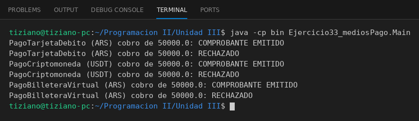

# MedioPago

Programación II - Unidad 3 - Ejercicio 33

## Consigna
Modelar una jerarquía de clases con herencia: una clase base y subclases que reutilizan código con `super` y sobrescriben métodos. Medios de pago electrónicos.

## Lógica
- `MedioPago` valida que el monto sea positivo.
- `PagoTarjetaDebito` controla saldo, `PagoCriptomoneda` suma comisión de red y `PagoBilleteraVirtual` controla límite diario.
- `Main` procesa cobros polimórficos sobre una lista.

## Ejecución

